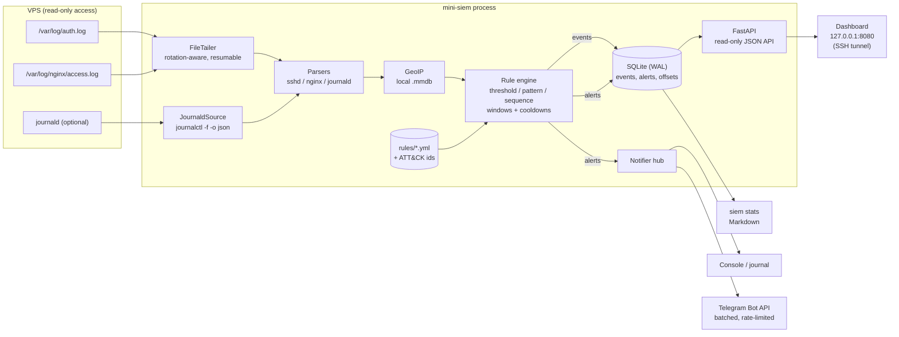

# mini-siem

[](https://github.com/<your-github-user>/mini-siem/actions/workflows/ci.yml)


A small, self-hosted log monitoring and intrusion detection system for a single
Linux server. It tails `sshd` and nginx logs, runs them through YAML detection
rules mapped to MITRE ATT&CK, stores events and alerts in SQLite, sends batched
Telegram alerts and serves a read-only dashboard with an attack map.

I run it next to a production website on a small VPS, so it is built to be a
**read-only guest**: it never touches nginx, sshd or the firewall, never opens a
public port and runs with tight CPU and memory limits.

<!-- DEMO: replace with a real recording, e.g. docs/demo.gif (dashboard + Telegram alert) -->
> **Demo GIF placeholder** - `docs/demo.gif`: dashboard filling up while the log generator runs.

<!-- SCREENSHOT: replace with docs/dashboard.png -->
> **Screenshot placeholder** - `docs/dashboard.png`: dashboard with attack map, hourly chart, top IPs and usernames.

<!-- SCREENSHOT: replace with docs/telegram.png -->
> **Screenshot placeholder** - `docs/telegram.png`: a batched Telegram alert.

---

## Features

- **Log collection** - asyncio `tail -F` for files that survives logrotate
  (create and copytruncate modes) and resumes from a saved offset after a
  restart; optional `journalctl -f -o json` source for distributions without
  `/var/log/auth.log`.
- **Parsers** - sshd (failed password, invalid user, accepted login; classic
  syslog *and* RFC 3339 timestamps; OpenSSH 9.8+ `sshd-session`), nginx
  combined access log (IPv4/IPv6, malformed requests).
- **Detection rules in YAML** with a validated schema: sliding-window
  threshold rules (optionally counting *distinct* values), pattern rules
  (regex on URL-decoded fields) and sequence rules ("success after N
  failures"). Per rule + key cooldown/de-duplication.
- **MITRE ATT&CK mapping** in every rule, stored with each alert and shown in
  the dashboard.
- **Alerts** to Telegram (batched and rate-limited, so a flood produces one
  message every few seconds, not thousands) and to the log. Notifiers sit
  behind a small interface so others are easy to add.
- **Storage** in SQLite (WAL) behind a thin interface, with a retention
  setting.
- **Dashboard** (FastAPI + Chart.js + jsVectorMap): attack map, hourly
  activity, top attacking IPs, most-tried usernames, alerts per rule, ATT&CK
  coverage, recent alerts. Binds to `127.0.0.1`, optional basic auth / token.
- **GeoIP** via a local MaxMind GeoLite2 or DB-IP `.mmdb` file, degrading to
  "unknown" without one.
- **`siem stats`** prints a Markdown summary for this README.
- **Demo mode** - a log generator produces realistic traffic with attacks
  mixed in, so everything runs locally without a server.

## Architecture



Every line goes through the same synchronous path (parse, enrich, evaluate,
buffer), so ordering is deterministic. Rule windows use **event time**, not
wall-clock time, which means replaying an old log yields exactly the alerts a
live run would have produced. Offsets are committed in the same SQLite
transaction as the events they cover, giving at-least-once processing across
restarts.

## Quick start (demo, one command)

```bash
docker compose -f docker-compose.demo.yml up --build
```

Then open <http://127.0.0.1:8080>. The `generator` container writes 24 hours of
fake history and keeps appending live traffic (at 20x speed); the `siem`
container tails it. All addresses come from the documentation ranges
(`192.0.2.0/24`, `198.51.100.0/24`, `203.0.113.0/24`, `2001:db8::/32`), which
`demo/demo-geo.yml` maps to made-up countries so the map has something to show.

### Without Docker

```bash
python -m venv .venv && source .venv/bin/activate     # Windows: .venv\Scripts\activate
pip install -e ".[dev]"

python tools/generate_logs.py --out demo/logs --hours 24     # history
siem -c config.demo.yml run                                 # monitor + dashboard
# optional, in another terminal: live traffic
python tools/generate_logs.py --out demo/logs --hours 0 --append --follow --speed 30
```

`siem -c config.demo.yml stats --days 1` then prints a summary of the demo data.

## Running it on a real server

See **[DEPLOY.md](DEPLOY.md)** for the step-by-step guide (Docker or systemd).
In short:

```bash
cp .env.example .env && nano .env        # Telegram token / chat id
nano config.yml                          # ignore_networks, retention_days
docker compose up -d --build
ssh -N -L 8080:127.0.0.1:8080 you@server # from your laptop, then http://localhost:8080
```

The production `docker-compose.yml` mounts `/var/log` read-only, runs as a
non-root user in group `adm` with all capabilities dropped and a read-only
root filesystem, keeps the database in a named volume and publishes the
dashboard on `127.0.0.1` only.

## Configuration

`config.yml` holds behaviour, the environment (or `.env`) holds secrets.

| Key | Default | Meaning |
|---|---|---|
| `database` | `data/siem.db` | SQLite file (`SIEM_DB` overrides) |
| `rules` | `rules` | directory of `*.yml` rule files |
| `retention_days` | `30` | events/alerts older than this are deleted hourly |
| `log_timezone` | `local` | timezone of classic syslog timestamps (`UTC`, `Europe/Istanbul`, ...) |
| `store_all_http` | `false` | store every request or only suspicious ones |
| `ignore_networks` | `[]` | CIDRs that never alert (your own IPs) |
| `sources` | auth.log + nginx | `type: file` (`path`, `parser: auth\|nginx`, `from_beginning`) or `type: journald` |
| `geoip.database` | `/var/lib/GeoIP/GeoLite2-Country.mmdb` | optional `.mmdb` |
| `dashboard.host/port` | `127.0.0.1:8080` | `SIEM_DASHBOARD_HOST/PORT` override |
| `telegram.min_severity` | `medium` | lowest severity sent to Telegram |
| `telegram.batch_interval` | `10` | seconds between messages (at most one per interval) |

| Environment variable | Purpose |
|---|---|
| `TELEGRAM_BOT_TOKEN`, `TELEGRAM_CHAT_ID` | enable Telegram alerts |
| `SIEM_DASHBOARD_USER`, `SIEM_DASHBOARD_PASSWORD` | HTTP basic auth for the dashboard |
| `SIEM_DASHBOARD_TOKEN` | bearer token for API clients |
| `SIEM_HOSTNAME` | name shown in Telegram messages |

## Writing rules

Rules live in `rules/*.yml`. Every file has a top-level `rules:` list; the
schema is strict (unknown keys, bad regexes, malformed ATT&CK ids and duplicate
ids are rejected at startup). Validate with:

```bash
siem check-rules            # or: siem check-rules path/to/rules
```

### Common keys

| Key | Required | Description |
|---|---|---|
| `id` | yes | lowercase, `[a-z0-9_-]`, unique across files |
| `name` | yes | human-readable title |
| `type` | yes | `threshold`, `pattern` or `sequence` |
| `severity` | | `low`, `medium` (default), `high`, `critical` |
| `match` | | conditions that must all hold; a list means "any of" |
| `exclude` | | skip the event if *any* of these conditions holds |
| `group_by` | | field that identifies the actor (default `src_ip`) |
| `cooldown` | | seconds before the same rule + key may alert again (default 300) |
| `message` | | template with `{key} {count} {window} {src_ip} {user} {path} {user_agent} {match}` |
| `mitre` | | list of ATT&CK technique ids, e.g. `[T1110.001]` |
| `enabled` | | `false` to switch a rule off |

### Fields you can match on

| Event type (`event_type`) | Source | Fields |
|---|---|---|
| `ssh_failed` | auth.log / journald | `src_ip`, `user`, `method`, `port`, `invalid_user`, `host` |
| `ssh_invalid_user` | auth.log / journald | `src_ip`, `user`, `port`, `host` |
| `ssh_accepted` | auth.log / journald | `src_ip`, `user`, `method`, `port`, `host` |
| `http_request` | nginx | `src_ip`, `method`, `path`, `protocol`, `status`, `bytes`, `referer`, `user_agent` |

### Threshold: N events per key within a sliding window

```yaml
- id: ssh-bruteforce
  name: SSH brute force
  type: threshold
  severity: high
  match: {event_type: ssh_failed}
  group_by: src_ip
  threshold: 5          # 5 failures ...
  window: 60            # ... within 60 seconds
  cooldown: 600
  mitre: [T1110.001]
```

Add `distinct: <field>` to count distinct values instead of events, e.g.
"20 *different* 404 paths in a minute" (`distinct: path`) or "8 different
invalid usernames" (`distinct: user`). After firing, the window is reset.

### Pattern: a single suspicious event

```yaml
- id: web-path-traversal
  name: Path traversal attempt
  type: pattern
  severity: high
  match: {event_type: http_request}
  patterns:
    - field: path
      regex: ["\\.\\.[/\\\\]", "/etc/(passwd|shadow)\\b"]
  mitre: [T1190, T1083]
```

`patterns` is a list; the rule fires if **any** regex of **any** entry matches.
Values are URL-decoded up to three times (`decode: true`, the default) and
both the raw and decoded forms are checked, so `%2e%2e%2f` and
`%252e%252e%252f` are caught. Matching is case-insensitive unless
`ignore_case: false`. A pattern rule without `patterns` fires on `match` alone
(see `ssh-root-login`).

### Sequence: something good after something bad

```yaml
- id: ssh-login-after-failures
  name: Successful SSH login after repeated failures
  type: sequence
  severity: critical
  match: {event_type: ssh_failed}          # the "before" events
  followed_by: {event_type: ssh_accepted}  # the trigger
  group_by: src_ip
  threshold: 5
  window: 900
  mitre: [T1110.001, T1078]
```

### Testing a rule

Write a few log lines into a file and replay them; alerts are printed and
stored in the configured database:

```bash
siem -c config.demo.yml replay --parser nginx my-test-access.log
```

The test suite (`tests/test_rules.py`) has many more examples.

## Shipped rules and MITRE ATT&CK mapping

| Rule | Type | Severity | ATT&CK technique(s) |
|---|---|---|---|
| `ssh-bruteforce` - 5 failed logins / 60 s from one IP | threshold | high | [T1110.001](https://attack.mitre.org/techniques/T1110/001/) Brute Force: Password Guessing |
| `ssh-user-enumeration` - 8 distinct invalid users / 5 min | threshold | medium | [T1110.003](https://attack.mitre.org/techniques/T1110/003/) Brute Force: Password Spraying |
| `ssh-login-after-failures` - success after >= 5 failures | sequence | critical | [T1110.001](https://attack.mitre.org/techniques/T1110/001/), [T1078](https://attack.mitre.org/techniques/T1078/) Valid Accounts |
| `ssh-root-login` - successful login as root | pattern | high | [T1078.003](https://attack.mitre.org/techniques/T1078/003/) Local Accounts, [T1021.004](https://attack.mitre.org/techniques/T1021/004/) Remote Services: SSH |
| `web-directory-scan` - 20 distinct 404 paths / 60 s | threshold | medium | [T1595.003](https://attack.mitre.org/techniques/T1595/003/) Active Scanning: Wordlist Scanning |
| `web-scanner-user-agent` - sqlmap, Nikto, Nmap, nuclei, ... | pattern | medium | [T1595.002](https://attack.mitre.org/techniques/T1595/002/) Active Scanning: Vulnerability Scanning |
| `web-path-traversal` - `../`, `/etc/passwd`, encoded variants | pattern | high | [T1190](https://attack.mitre.org/techniques/T1190/) Exploit Public-Facing Application, [T1083](https://attack.mitre.org/techniques/T1083/) File and Directory Discovery |
| `web-sqli-probe` - `UNION SELECT`, `' OR '1'='1`, `SLEEP()` | pattern | high | [T1190](https://attack.mitre.org/techniques/T1190/) |
| `web-xss-probe` - `<script>`, `onerror=`, `javascript:` | pattern | medium | [T1190](https://attack.mitre.org/techniques/T1190/) |
| `web-sensitive-file-probe` - `.env`, `.git/config`, keys | pattern | medium | [T1595.003](https://attack.mitre.org/techniques/T1595/003/), [T1552.001](https://attack.mitre.org/techniques/T1552/001/) Credentials In Files |
| `web-rce-probe` - Log4Shell `${jndi:`, shell injection, Shellshock | pattern | high | [T1190](https://attack.mitre.org/techniques/T1190/), [T1059](https://attack.mitre.org/techniques/T1059/) Command and Scripting Interpreter |

The mapping describes what the *attempt* looks like; a probe alert does not
mean the application was vulnerable.

## Telegram alerts

Alerts at or above `telegram.min_severity` are queued and sent by a background
task at most once every `batch_interval` seconds. Each message lists up to
`max_alerts_per_message` alerts in detail and summarises the rest per rule
("... and 225 more: ssh-bruteforce x195, web-sqli-probe x30"). The queue is
bounded; overflow is counted, not lost silently. HTTP 429 responses are retried
after Telegram's `retry_after`; the bot token is never written to the log
(httpx request logging is turned down for that reason).

## GeoIP

No database is bundled or downloaded automatically. Without one, countries
show as "unknown". Two free options:

- **MaxMind GeoLite2 Country** - create a free account at
  <https://www.maxmind.com/en/geolite2/signup>, generate a license key and
  either download `GeoLite2-Country.mmdb` manually or use `geoipupdate`
  (`apt install geoipupdate`, configure `/etc/GeoIP.conf`). The GeoLite2 EULA
  requires keeping the database up to date.
- **DB-IP IP to Country Lite** - monthly `.mmdb` from
  <https://db-ip.com/db/download/ip-to-country-lite>, licensed CC BY 4.0
  (attribution required if you publish results: "IP geolocation by DB-IP").

Point `geoip.database` at the file (Docker: drop it into `./geoip/` as
`GeoLite2-Country.mmdb`). City databases work too; only the country is used.

## Dashboard and API

The dashboard is a single static page that polls a read-only JSON API every
30 seconds. Everything rendered from logs (usernames, paths, user agents) is
attacker-controlled, so the page builds DOM nodes with `textContent` only, and
the server sends a strict Content-Security-Policy (scripts only from itself
and jsDelivr, pinned versions with Subresource Integrity hashes).

| Endpoint | Returns |
|---|---|
| `GET /api/summary?days=7` | totals: SSH attempts, logins, suspicious HTTP, attacker IPs, usernames, alerts |
| `GET /api/top-ips?days=7&limit=10` | top attacking IPs with country, SSH/HTTP counts, first/last seen |
| `GET /api/top-usernames?days=7&limit=10` | most-tried SSH usernames |
| `GET /api/countries?days=7` | suspicious events per country (`??` = unknown) |
| `GET /api/hourly?hours=48` | per-hour SSH attempts, suspicious HTTP requests, alerts |
| `GET /api/alerts/recent?limit=50` | latest alerts with ATT&CK technique details |
| `GET /api/alerts/by-rule?days=7` | alert counts per rule |
| `GET /api/mitre?days=7` | techniques covered by the loaded rules, with alert counts |
| `GET /healthz` | liveness (no auth) |

## CLI

```text
siem run            monitor logs and serve the dashboard (what the service runs)
siem monitor        monitor only
siem dashboard      dashboard only
siem replay         --parser auth|nginx|journald FILE...   process files once
siem stats          --days 30 [--limit 10] [--full-ips]    Markdown summary
siem check-rules    [PATH]                                 validate rule files
siem prune          [--days N]                             apply retention now
```

Global options: `-c/--config FILE` (or `SIEM_CONFIG`), `-v/--verbose`.

## Real-world results

> **Placeholder - not real data yet.** This section will be filled in from
> `siem stats --days 30` after the sensor has run on my VPS for a month. Until
> then every number below is a placeholder, not a measurement.

<!-- BEGIN: paste the output of `siem stats --days 30` here -->

| Metric | Value |
|---|---:|
| SSH login attempts | `<TODO from siem stats>` |
| Average SSH attempts per day | `<TODO>` |
| Distinct usernames tried | `<TODO>` |
| Suspicious HTTP requests | `<TODO>` |
| Unique attacking IP addresses | `<TODO>` |
| Alerts raised | `<TODO>` |

**Most-tried usernames:** `<TODO: table from siem stats>`

**Top source countries:** `<TODO: table from siem stats>`

**Alerts by rule:** `<TODO: table from siem stats>`

<!-- END -->

**Observations:** `<TODO: what surprised me after a month, e.g. how quickly a
new server is found, which usernames dominate, what the scanners look for>`

## Privacy

Attacker IP addresses can be personal data (for example under the GDPR and
the Turkish KVKK), even when they belong to a botnet. mini-siem therefore:

- keeps data only on your own server and only for `retention_days`
  (30 by default; pruned hourly);
- stores only *suspicious* HTTP requests unless `store_all_http: true`, so
  normal visitors of the website are not recorded;
- masks the host part of IP addresses in `siem stats` output by default
  (`203.0.113.x`), so README statistics can be published safely
  (`--full-ips` turns this off);
- sends nothing anywhere except the alerts you configure for Telegram.

If you operate this for an organisation, document the purpose (security of
the service, a legitimate interest) and the retention period in your privacy
notice.

## Limitations

- Single host, single process; no log shipping or clustering.
- Detection only: it does not block anything. Pair it with fail2ban or
  firewall rules if you want active response.
- SQLite is the only storage backend. The `Storage` interface is small enough
  for a PostgreSQL implementation, but I have not written one.
- Pattern rules on URLs are signatures; they produce false positives on
  unusual but legitimate URLs and miss novel payloads.
- Behind a reverse proxy/CDN, nginx must log the real client IP.
- Classic syslog lines have no year or timezone; `log_timezone` must match
  the host.
- The journald source needs `journalctl`, so it is meant for the systemd
  install rather than the container.

## Why I built this / what I learned

I host a website on a small VPS and wanted to know what actually hits it,
without paying for a SaaS SIEM or running an Elastic stack that would need
more RAM than the site itself. Building a small SIEM end to end was also the
best way I could think of to learn how detection engineering works in
practice.

Things I learned along the way:

- **Log tailing is harder than `readline()` in a loop.** Rotation
  (create vs. copytruncate), partial lines, files that disappear for a moment
  and resuming without skipping or duplicating lines all needed explicit
  handling and tests. One real bug: the offset of a source was saved before
  the file was opened, which made it re-read from the beginning after a
  restart. The integration test caught it.
- **Event time vs. wall-clock time.** Evaluating windows on log timestamps
  makes detections reproducible and lets me replay old logs as a test.
- **Writing rules is about false positives.** "5 failures in 60 s" is easy;
  deciding not to double-count `Invalid user` and `Failed password for
  invalid user` (the same attempt, logged twice), or counting *distinct* 404
  paths instead of 404s, is where the work is.
- **MITRE ATT&CK as a vocabulary.** Mapping every rule to a technique forced
  me to think about what each alert actually means, and shows coverage gaps.
- **Alert fatigue is a design problem.** Cooldowns per rule + key and
  batched Telegram messages make the difference between a useful signal and
  a muted chat.
- **Deploying next to production.** Read-only mounts, a dedicated user in
  `adm`, systemd sandboxing, resource limits and loopback-only binding mean
  the monitor cannot hurt the thing it is protecting.
- **Logs are attacker input.** Usernames and URLs end up in the dashboard,
  so output encoding and a CSP matter even for an internal tool.

## Development

```bash
pip install -e ".[dev]"
ruff check . && ruff format --check .
pytest
```

The test suite covers the parsers with real-looking log lines, rule windows,
distinct counting, cooldowns and sequences, tailer rotation/truncation/resume,
the Telegram notifier against a mocked Bot API, the storage queries, the API
endpoints including authentication, and a full generate -> replay -> alert
round trip. GitHub Actions runs ruff and pytest on Python 3.11-3.13 for every
push.

Project layout:

```text
src/minisiem/
  parsers/       sshd (auth.log + journald) and nginx parsers
  detection/     rule schema (pydantic) and stateful engine
  notifiers/     notifier interface, console and Telegram
  web/           FastAPI app and static dashboard
  sources.py     file tailer and journald reader
  storage.py     SQLite storage
  monitor.py     the pipeline
  stats.py       siem stats
  cli.py         command line
rules/           detection rules (YAML)
tools/           sample log generator
deploy/          systemd unit and install script
```

## License

[MIT](LICENSE) © 2026 Emre Özaydın
