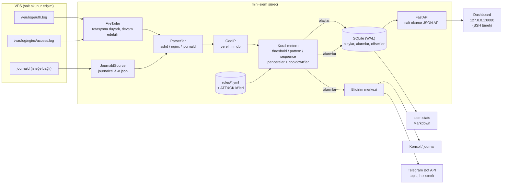

# mini-siem

🇬🇧 [English](README.md)

[](https://github.com/rosko35/mini-siem/actions/workflows/ci.yml)


Tek bir Linux sunucusu için geliştirilmiş, küçük ve kendi sunucunda barındırılan
bir log izleme ve saldırı tespit sistemi. `sshd` ve nginx loglarını takip eder,
bunları MITRE ATT&CK ile eşleştirilmiş YAML tespit kurallarından geçirir, olayları
ve alarmları SQLite'ta saklar, toplu (batch) Telegram alarmları gönderir ve saldırı
haritası olan salt okunur bir dashboard (pano) sunar.

Bunu küçük bir VPS'te, canlı bir web sitesinin yanında çalıştırıyorum. Bu yüzden
**salt okunur bir misafir** olacak şekilde tasarlandı: nginx'e, sshd'ye veya
güvenlik duvarına asla dokunmaz, hiçbir public port açmaz ve sıkı CPU ve bellek
limitleriyle çalışır.

<!-- DEMO: replace with a real recording, e.g. docs/demo.gif (dashboard + Telegram alert) -->
> **Demo GIF yer tutucusu** - `docs/demo.gif`: log üreteci çalışırken dolan dashboard.

<!-- SCREENSHOT: replace with docs/dashboard.png -->
> **Ekran görüntüsü yer tutucusu** - `docs/dashboard.png`: saldırı haritası, saatlik grafik, en çok saldıran IP'ler ve kullanıcı adlarının olduğu dashboard.

<!-- SCREENSHOT: replace with docs/telegram.png -->
> **Ekran görüntüsü yer tutucusu** - `docs/telegram.png`: toplu (batch) bir Telegram alarmı.

---

## Özellikler

- **Log toplama** - Dosyalar için logrotate'ten (create ve copytruncate
  modları) etkilenmeyen, asyncio tabanlı `tail -F`; yeniden başlatmadan sonra
  kayıtlı offset'ten devam eder. `/var/log/auth.log` olmayan dağıtımlar için
  isteğe bağlı `journalctl -f -o json` kaynağı vardır.
- **Parser'lar** - sshd (failed password, invalid user, accepted login ve
  "authenticating user ... [preauth]" biçimindeki pre-auth bağlantı kopmaları;
  bunlar yalnızca anahtarla giriş yapılan sunucularda brute force'un tek
  izidir; klasik syslog *ve* RFC 3339 zaman damgaları; OpenSSH 9.8+
  `sshd-session`), nginx combined access log (IPv4/IPv6, hatalı biçimlenmiş
  istekler).
- **YAML ile tespit kuralları**, doğrulanan bir şemayla: kayan pencereli
  eşik (threshold) kuralları (istenirse *farklı* değerleri sayar), desen
  (pattern) kuralları (URL-decode edilmiş alanlar üzerinde regex) ve sıra
  (sequence) kuralları ("N başarısızlıktan sonra başarılı giriş"). Kural +
  anahtar başına cooldown (bekleme süresi) ve tekrar eden alarmları eleme
  (de-duplication) vardır.
- Her kuralda **MITRE ATT&CK eşlemesi** bulunur; her alarmla birlikte saklanır
  ve dashboard'da gösterilir.
- **Alarmlar** Telegram'a (toplu ve hız sınırlı; yani bir saldırı seli binlerce
  mesaj yerine birkaç saniyede bir tek mesaj üretir) ve loga gönderilir.
  Bildirim kanalları küçük bir arayüzün arkasında durur, bu yüzden yenilerini
  eklemek kolaydır.
- **Depolama** SQLite'ta (WAL), ince bir arayüzün arkasında ve bir saklama
  süresi (retention) ayarıyla yapılır.
- **Dashboard** (FastAPI + Chart.js + jsVectorMap): saldırı haritası, saatlik
  aktivite, en çok saldıran IP'ler, en çok denenen kullanıcı adları, kural
  başına alarmlar, ATT&CK kapsamı, son alarmlar. `127.0.0.1` adresine bağlanır;
  isteğe bağlı basic auth / token vardır.
- **GeoIP**, yerel bir MaxMind GeoLite2 veya DB-IP `.mmdb` dosyası üzerinden
  çalışır; dosya yoksa "unknown" (bilinmiyor) değerine düşer.
- **`siem stats`**, bu README için bir Markdown özeti yazdırır.
- **Demo modu** - bir log üreteci, araya saldırıların karıştığı gerçekçi bir
  trafik üretir; böylece her şey sunucu olmadan yerelde çalışır.

## Mimari



Her satır aynı senkron yoldan geçer (parse, zenginleştirme, değerlendirme,
tamponlama); bu yüzden sıralama deterministiktir. Kural pencereleri duvar saati
zamanını değil **olay zamanını** kullanır; yani eski bir logu tekrar oynatmak
(replay), canlı çalışmanın üreteceği alarmların aynısını üretir. Offset'ler,
kapsadıkları olaylarla aynı SQLite transaction'ında commit edilir; bu da
yeniden başlatmalar boyunca en az bir kez (at-least-once) işleme garantisi verir.

## Hızlı başlangıç (demo, tek komut)

```bash
docker compose -f docker-compose.demo.yml up --build
```

Sonra <http://127.0.0.1:8080> adresini aç. `generator` container'ı 24 saatlik
sahte geçmiş yazar ve canlı trafiği (20 kat hızda) eklemeye devam eder; `siem`
container'ı bunu takip eder. Tüm adresler dokümantasyon aralıklarından gelir
(`192.0.2.0/24`, `198.51.100.0/24`, `203.0.113.0/24`, `2001:db8::/32`);
`demo/demo-geo.yml` bunları uydurma ülkelere eşler, böylece haritada gösterecek
bir şey olur.

### Docker olmadan

```bash
python -m venv .venv && source .venv/bin/activate     # Windows: .venv\Scripts\activate
pip install -e ".[dev]"

python tools/generate_logs.py --out demo/logs --hours 24     # geçmiş
siem -c config.demo.yml run                                 # izleme + dashboard
# isteğe bağlı, başka bir terminalde: canlı trafik
python tools/generate_logs.py --out demo/logs --hours 0 --append --follow --speed 30
```

Ardından `siem -c config.demo.yml stats --days 1` komutu demo verisinin
özetini yazdırır.

## Gerçek bir sunucuda çalıştırmak

Adım adım rehber (Docker veya systemd) için **[DEPLOY.tr.md](DEPLOY.tr.md)**
dosyasına bak. Kısaca:

```bash
cp .env.example .env && nano .env        # Telegram token / chat id
nano config.yml                          # ignore_networks, retention_days
docker compose up -d --build
ssh -N -L 8080:127.0.0.1:8080 you@server # kendi bilgisayarından, sonra http://localhost:8080
```

Production `docker-compose.yml`, `/var/log` dizinini salt okunur bağlar;
root olmayan bir kullanıcıyla, `adm` grubunda, tüm capability'ler kaldırılmış
ve salt okunur bir root dosya sistemiyle çalışır; veritabanını adlandırılmış
bir volume'da tutar ve dashboard'u yalnızca `127.0.0.1` üzerinde yayınlar.

## Yapılandırma

`config.yml` davranışı, ortam değişkenleri (veya `.env`) ise gizli bilgileri
(secrets) tutar.

| Anahtar | Varsayılan | Anlamı |
|---|---|---|
| `database` | `data/siem.db` | SQLite dosyası (`SIEM_DB` bunu geçersiz kılar) |
| `rules` | `rules` | `*.yml` kural dosyalarının bulunduğu dizin |
| `retention_days` | `30` | bundan eski olaylar/alarmlar her saat silinir |
| `log_timezone` | `local` | klasik syslog zaman damgalarının saat dilimi (`UTC`, `Europe/Istanbul`, ...) |
| `store_all_http` | `false` | her isteği mi, yoksa yalnızca şüpheli olanları mı saklayacağı |
| `ignore_networks` | `[]` | asla alarm üretmeyen CIDR'ler (kendi IP'lerin) |
| `sources` | auth.log + nginx | `type: file` (`path`, `parser: auth\|nginx`, `from_beginning`) veya `type: journald` |
| `geoip.database` | `/var/lib/GeoIP/GeoLite2-Country.mmdb` | isteğe bağlı `.mmdb` |
| `dashboard.host/port` | `127.0.0.1:8080` | `SIEM_DASHBOARD_HOST/PORT` bunu geçersiz kılar |
| `telegram.min_severity` | `medium` | Telegram'a gönderilen en düşük önem derecesi |
| `telegram.batch_interval` | `10` | mesajlar arasındaki saniye (her aralıkta en fazla bir mesaj) |

| Ortam değişkeni | Amacı |
|---|---|
| `TELEGRAM_BOT_TOKEN`, `TELEGRAM_CHAT_ID` | Telegram alarmlarını etkinleştirir |
| `SIEM_DASHBOARD_USER`, `SIEM_DASHBOARD_PASSWORD` | dashboard için HTTP basic auth |
| `SIEM_DASHBOARD_TOKEN` | API istemcileri için bearer token |
| `SIEM_HOSTNAME` | Telegram mesajlarında görünen ad |

## Kural yazmak

Kurallar `rules/*.yml` dosyalarında durur. Her dosyanın en üst düzeyinde bir
`rules:` listesi vardır; şema katıdır (bilinmeyen anahtarlar, hatalı regex'ler,
bozuk ATT&CK id'leri ve tekrar eden id'ler başlangıçta reddedilir). Doğrulamak
için:

```bash
siem check-rules            # veya: siem check-rules path/to/rules
```

### Ortak anahtarlar

| Anahtar | Zorunlu | Açıklama |
|---|---|---|
| `id` | evet | küçük harf, `[a-z0-9_-]`, dosyalar arasında benzersiz |
| `name` | evet | insanın okuyacağı başlık |
| `type` | evet | `threshold`, `pattern` veya `sequence` |
| `severity` | | `low`, `medium` (varsayılan), `high`, `critical` |
| `match` | | hepsinin sağlanması gereken koşullar; liste olursa "herhangi biri" anlamına gelir |
| `exclude` | | bu koşullardan *herhangi biri* sağlanıyorsa olayı atla |
| `group_by` | | aktörü tanımlayan alan (varsayılan `src_ip`) |
| `cooldown` | | aynı kural + anahtarın tekrar alarm üretebilmesi için geçmesi gereken saniye (varsayılan 300) |
| `message` | | `{key} {count} {window} {src_ip} {user} {path} {user_agent} {match}` alanlarını içerebilen şablon |
| `mitre` | | ATT&CK teknik id'lerinin listesi, örn. `[T1110.001]` |
| `enabled` | | bir kuralı kapatmak için `false` |

### Üzerinde eşleştirme yapabileceğin alanlar

| Olay türü (`event_type`) | Kaynak | Alanlar |
|---|---|---|
| `ssh_failed` | auth.log / journald | `src_ip`, `user`, `method`, `port`, `invalid_user`, `host` |
| `ssh_invalid_user` | auth.log / journald | `src_ip`, `user`, `port`, `host` |
| `ssh_accepted` | auth.log / journald | `src_ip`, `user`, `method`, `port`, `host` |
| `http_request` | nginx | `src_ip`, `method`, `path`, `protocol`, `status`, `bytes`, `referer`, `user_agent` |

### Threshold: kayan pencere içinde anahtar başına N olay

```yaml
- id: ssh-bruteforce
  name: SSH brute force
  type: threshold
  severity: high
  match: {event_type: ssh_failed}
  group_by: src_ip
  threshold: 5          # 5 başarısızlık ...
  window: 60            # ... 60 saniye içinde
  cooldown: 600
  mitre: [T1110.001]
```

Olay yerine farklı değerleri saymak için `distinct: <field>` ekle; örneğin
"bir dakikada 20 *farklı* 404 yolu" (`distinct: path`) veya "8 farklı geçersiz
kullanıcı adı" (`distinct: user`). Alarm tetiklendikten sonra pencere sıfırlanır.

### Pattern: tek bir şüpheli olay

```yaml
- id: web-path-traversal
  name: Path traversal attempt
  type: pattern
  severity: high
  match: {event_type: http_request}
  patterns:
    - field: path
      regex: ["\\.\\.[/\\\\]", "/etc/(passwd|shadow)\\b"]
  mitre: [T1190, T1083]
```

`patterns` bir listedir; **herhangi bir** girdinin **herhangi bir** regex'i
eşleşirse kural tetiklenir. Değerler en fazla üç kez URL-decode edilir
(`decode: true`, varsayılan) ve hem ham hem decode edilmiş hâlleri kontrol
edilir; böylece `%2e%2e%2f` ve `%252e%252e%252f` yakalanır. `ignore_case: false`
verilmedikçe eşleştirme büyük/küçük harfe duyarsızdır. `patterns` içermeyen bir
pattern kuralı yalnızca `match` ile tetiklenir (bkz. `ssh-root-login`).

### Sequence: kötü bir şeyden sonra gelen iyi bir şey

```yaml
- id: ssh-login-after-failures
  name: Successful SSH login after repeated failures
  type: sequence
  severity: critical
  match: {event_type: ssh_failed}          # "önceki" olaylar
  followed_by: {event_type: ssh_accepted}  # tetikleyici
  group_by: src_ip
  threshold: 5
  window: 900
  mitre: [T1110.001, T1078]
```

### Bir kuralı test etmek

Bir dosyaya birkaç log satırı yaz ve tekrar oynat (replay); alarmlar ekrana
yazdırılır ve yapılandırılmış veritabanına kaydedilir:

```bash
siem -c config.demo.yml replay --parser nginx my-test-access.log
```

Test paketinde (`tests/test_rules.py`) çok daha fazla örnek var.

## Hazır gelen kurallar ve MITRE ATT&CK eşlemesi

| Kural | Tür | Önem | ATT&CK tekniği/teknikleri |
|---|---|---|---|
| `ssh-bruteforce` - tek bir IP'den 60 sn'de 5 başarısız giriş | threshold | high | [T1110.001](https://attack.mitre.org/techniques/T1110/001/) Brute Force: Password Guessing |
| `ssh-user-enumeration` - 5 dk'da 8 farklı geçersiz kullanıcı | threshold | medium | [T1110.003](https://attack.mitre.org/techniques/T1110/003/) Brute Force: Password Spraying |
| `ssh-login-after-failures` - >= 5 başarısızlıktan sonra başarılı giriş | sequence | critical | [T1110.001](https://attack.mitre.org/techniques/T1110/001/), [T1078](https://attack.mitre.org/techniques/T1078/) Valid Accounts |
| `ssh-root-login` - root olarak başarılı giriş | pattern | high | [T1078.003](https://attack.mitre.org/techniques/T1078/003/) Local Accounts, [T1021.004](https://attack.mitre.org/techniques/T1021/004/) Remote Services: SSH |
| `web-directory-scan` - 60 sn'de 20 farklı 404 yolu | threshold | medium | [T1595.003](https://attack.mitre.org/techniques/T1595/003/) Active Scanning: Wordlist Scanning |
| `web-scanner-user-agent` - sqlmap, Nikto, Nmap, nuclei, ... | pattern | medium | [T1595.002](https://attack.mitre.org/techniques/T1595/002/) Active Scanning: Vulnerability Scanning |
| `web-path-traversal` - `../`, `/etc/passwd`, encode edilmiş varyantlar | pattern | high | [T1190](https://attack.mitre.org/techniques/T1190/) Exploit Public-Facing Application, [T1083](https://attack.mitre.org/techniques/T1083/) File and Directory Discovery |
| `web-sqli-probe` - `UNION SELECT`, `' OR '1'='1`, `SLEEP()` | pattern | high | [T1190](https://attack.mitre.org/techniques/T1190/) |
| `web-xss-probe` - `<script>`, `onerror=`, `javascript:` | pattern | medium | [T1190](https://attack.mitre.org/techniques/T1190/) |
| `web-sensitive-file-probe` - `.env`, `.git/config`, anahtarlar | pattern | medium | [T1595.003](https://attack.mitre.org/techniques/T1595/003/), [T1552.001](https://attack.mitre.org/techniques/T1552/001/) Credentials In Files |
| `web-rce-probe` - Log4Shell `${jndi:`, shell injection, Shellshock | pattern | high | [T1190](https://attack.mitre.org/techniques/T1190/), [T1059](https://attack.mitre.org/techniques/T1059/) Command and Scripting Interpreter |

Bu eşleme, *denemenin* neye benzediğini anlatır; bir probe alarmı uygulamanın
savunmasız olduğu anlamına gelmez.

## Telegram alarmları

`telegram.min_severity` seviyesindeki ve üstündeki alarmlar kuyruğa alınır ve
bir arka plan görevi tarafından en fazla her `batch_interval` saniyede bir
gönderilir. Her mesaj en fazla `max_alerts_per_message` alarmı ayrıntılı
listeler, geri kalanları kural başına özetler ("... ve 225 tane daha:
ssh-bruteforce x195, web-sqli-probe x30"). Kuyruk sınırlıdır; taşan alarmlar
sessizce kaybolmaz, sayılır. HTTP 429 yanıtları Telegram'ın `retry_after`
süresinden sonra yeniden denenir; bot token'ı asla loga yazılmaz (bu yüzden
httpx istek loglaması kısılmıştır).

## GeoIP

Hiçbir veritabanı pakete dahil değildir ve otomatik indirilmez. Veritabanı
yoksa ülkeler "unknown" (bilinmiyor) olarak görünür. İki ücretsiz seçenek var:

- **MaxMind GeoLite2 Country** - <https://www.maxmind.com/en/geolite2/signup>
  adresinde ücretsiz bir hesap aç, bir lisans anahtarı üret ve
  `GeoLite2-Country.mmdb` dosyasını elle indir ya da `geoipupdate` kullan
  (`apt install geoipupdate`, `/etc/GeoIP.conf` dosyasını yapılandır).
  GeoLite2 EULA'sı veritabanını güncel tutmayı şart koşar.
- **DB-IP IP to Country Lite** - aylık `.mmdb` dosyası,
  <https://db-ip.com/db/download/ip-to-country-lite> adresinden; CC BY 4.0
  lisanslıdır (sonuçları yayımlarsan atıf gerekir: "IP geolocation by DB-IP").

`geoip.database` ayarını dosyanın yoluna yönlendir (Docker'da dosyayı
`GeoLite2-Country.mmdb` adıyla `./geoip/` içine koy). Şehir veritabanları da
çalışır; yalnızca ülke bilgisi kullanılır.

## Dashboard ve API

Dashboard, salt okunur bir JSON API'yi her 30 saniyede bir sorgulayan tek bir
statik sayfadır. Loglardan gelen her şey (kullanıcı adları, yollar, user agent'lar)
saldırganın kontrolündedir; bu yüzden sayfa DOM düğümlerini yalnızca
`textContent` ile oluşturur ve sunucu katı bir Content-Security-Policy gönderir
(script'ler yalnızca kendisinden ve jsDelivr'den, Subresource Integrity
hash'li sabitlenmiş sürümlerle yüklenir).

| Endpoint | Döndürdüğü |
|---|---|
| `GET /api/summary?days=7` | toplamlar: SSH denemeleri, girişler, şüpheli HTTP, saldırgan IP'ler, kullanıcı adları, alarmlar |
| `GET /api/top-ips?days=7&limit=10` | ülke, SSH/HTTP sayıları, ilk/son görülme ile en çok saldıran IP'ler |
| `GET /api/top-usernames?days=7&limit=10` | en çok denenen SSH kullanıcı adları |
| `GET /api/countries?days=7` | ülke başına şüpheli olaylar (`??` = bilinmiyor) |
| `GET /api/hourly?hours=48` | saat başına SSH denemeleri, şüpheli HTTP istekleri, alarmlar |
| `GET /api/alerts/recent?limit=50` | ATT&CK teknik ayrıntılarıyla son alarmlar |
| `GET /api/alerts/by-rule?days=7` | kural başına alarm sayıları |
| `GET /api/mitre?days=7` | yüklü kuralların kapsadığı teknikler ve alarm sayıları |
| `GET /healthz` | liveness (canlılık) kontrolü (kimlik doğrulama yok) |

## CLI

```text
siem run            logları izler ve dashboard'u sunar (servisin çalıştırdığı komut)
siem monitor        yalnızca izleme
siem dashboard      yalnızca dashboard
siem replay         --parser auth|nginx|journald FILE...   dosyaları bir kez işler
siem stats          --days 30 [--limit 10] [--full-ips]    Markdown özeti
siem check-rules    [PATH]                                 kural dosyalarını doğrular
siem prune          [--days N]                             saklama süresini şimdi uygular
```

Genel seçenekler: `-c/--config FILE` (veya `SIEM_CONFIG`), `-v/--verbose`.

## Gerçek dünya sonuçları

> **Yer tutucu - henüz gerçek veri değil.** Bu bölüm, sensör VPS'imde bir ay
> çalıştıktan sonra `siem stats --days 30` çıktısıyla doldurulacak. O zamana
> kadar aşağıdaki her sayı bir ölçüm değil, yer tutucudur.

<!-- BEGIN: paste the output of `siem stats --days 30` here -->

| Metrik | Değer |
|---|---:|
| SSH giriş denemeleri | `<TODO from siem stats>` |
| Günlük ortalama SSH denemesi | `<TODO>` |
| Denenen farklı kullanıcı adları | `<TODO>` |
| Şüpheli HTTP istekleri | `<TODO>` |
| Benzersiz saldırgan IP adresleri | `<TODO>` |
| Üretilen alarmlar | `<TODO>` |

**En çok denenen kullanıcı adları:** `<TODO: table from siem stats>`

**En çok saldırı gelen ülkeler:** `<TODO: table from siem stats>`

**Kurala göre alarmlar:** `<TODO: table from siem stats>`

<!-- END -->

**Gözlemler:** `<TODO: bir ay sonra beni neyin şaşırttığı; örn. yeni bir sunucunun ne kadar çabuk bulunduğu, hangi kullanıcı adlarının öne çıktığı, tarayıcıların neleri aradığı>`

## Gizlilik

Saldırgan IP adresleri, bir botnet'e ait olsalar bile kişisel veri olabilir
(örneğin GDPR ve Türkiye'deki KVKK kapsamında). Bu yüzden mini-siem:

- veriyi yalnızca kendi sunucunda ve yalnızca `retention_days` süresince
  tutar (varsayılan 30; her saat temizlenir);
- `store_all_http: true` olmadıkça yalnızca *şüpheli* HTTP isteklerini saklar,
  böylece web sitesinin normal ziyaretçileri kaydedilmez;
- `siem stats` çıktısında IP adreslerinin host kısmını varsayılan olarak
  maskeler (`203.0.113.x`), böylece README istatistikleri güvenle yayımlanabilir
  (`--full-ips` bunu kapatır);
- Telegram için yapılandırdığın alarmlar dışında hiçbir yere hiçbir şey
  göndermez.

Bunu bir kurum için işletiyorsan, amacı (hizmetin güvenliği, meşru menfaat) ve
saklama süresini gizlilik bildiriminde belgele.

## Sınırlamalar

- Tek host, tek süreç; log taşıma (shipping) veya cluster yok.
- Yalnızca tespit yapar, hiçbir şeyi engellemez. Aktif müdahale istiyorsan
  fail2ban veya güvenlik duvarı kurallarıyla birlikte kullan.
- Tek depolama backend'i SQLite'tır. `Storage` arayüzü bir PostgreSQL
  gerçeklemesi için yeterince küçüktür, ama ben bunu yazmadım.
- URL'ler üzerindeki pattern kuralları imzadır (signature); alışılmadık ama
  meşru URL'lerde yanlış pozitif (false positive) üretirler ve yeni payload'ları
  kaçırırlar.
- Bir reverse proxy/CDN'in arkasında nginx'in gerçek istemci IP'sini loglaması
  gerekir.
- Klasik syslog satırlarında yıl veya saat dilimi yoktur; `log_timezone`
  host ile aynı olmalıdır.
- journald kaynağı `journalctl` gerektirir; bu yüzden container için değil,
  systemd kurulumu için tasarlanmıştır.

## Bunu neden yaptım / ne öğrendim

Küçük bir VPS'te bir web sitesi barındırıyorum ve ona gerçekte neyin
saldırdığını bilmek istedim; bunun için ne SaaS bir SIEM'e para ödemek ne de
sitenin kendisinden daha fazla RAM isteyecek bir Elastic stack çalıştırmak
istedim. Küçük bir SIEM'i baştan sona yazmak, tespit mühendisliğinin (detection
engineering) pratikte nasıl işlediğini öğrenmek için aklıma gelen en iyi yoldu.

Yol boyunca öğrendiklerim:

- **Log takibi, bir döngüde `readline()` çağırmaktan daha zor.** Rotasyon
  (create ve copytruncate), yarım satırlar, bir an için kaybolan dosyalar ve
  satır atlamadan ya da tekrarlamadan devam etmek için açıkça kod ve test
  yazmam gerekti. Gerçek bir hata: bir kaynağın offset'i dosya açılmadan önce
  kaydediliyordu; bu da yeniden başlatmadan sonra dosyanın baştan okunmasına
  yol açıyordu. Entegrasyon testi bunu yakaladı.
- **Olay zamanı ve duvar saati zamanı.** Pencereleri log zaman damgalarına göre
  değerlendirmek tespitleri tekrarlanabilir kılıyor ve eski logları test olarak
  tekrar oynatmama izin veriyor.
- **Kural yazmak yanlış pozitiflerle uğraşmaktır.** "60 saniyede 5 başarısızlık"
  kolay; asıl iş, `Invalid user` ile `Failed password for invalid user` satırını
  (aynı deneme, iki kez loglanıyor) çift saymamaya karar vermekte ya da 404'leri
  değil *farklı* 404 yollarını saymakta.
- **Bir söz dağarcığı olarak MITRE ATT&CK.** Her kuralı bir teknikle eşleştirmek,
  her alarmın gerçekte ne anlama geldiğini düşünmeye zorladı ve kapsam
  boşluklarını gösteriyor.
- **Alarm yorgunluğu bir tasarım problemidir.** Kural + anahtar başına
  cooldown'lar ve toplu Telegram mesajları, işe yarar bir sinyal ile sessize
  alınmış bir sohbet arasındaki farkı yaratıyor.
- **Production'ın yanında çalışmak.** Salt okunur mount'lar, `adm` grubunda
  özel bir kullanıcı, systemd sandbox'ı, kaynak limitleri ve yalnızca loopback'e
  bağlanma; izleyicinin koruduğu şeye zarar verememesini sağlıyor.
- **Loglar saldırganın girdisidir.** Kullanıcı adları ve URL'ler dashboard'a
  ulaşıyor; bu yüzden çıktı kodlaması (output encoding) ve CSP, dahili bir araç
  için bile önemli.

## Geliştirme

```bash
pip install -e ".[dev]"
ruff check . && ruff format --check .
pytest
```

Test paketi şunları kapsar: gerçekçi log satırlarıyla parser'lar, kural
pencereleri, farklı değer sayımı (distinct), cooldown'lar ve sequence'lar,
tailer'ın rotasyon/kesilme/devam etme davranışı, sahte (mock) bir Bot API'ye
karşı Telegram bildirimcisi, depolama sorguları, kimlik doğrulama dahil API
endpoint'leri ve baştan sona bir üret -> replay -> alarm turu. GitHub Actions,
her push'ta ruff ve pytest'i Python 3.11-3.13 üzerinde çalıştırır.

Proje yapısı:

```text
src/minisiem/
  parsers/       sshd (auth.log + journald) and nginx parsers
  detection/     rule schema (pydantic) and stateful engine
  notifiers/     notifier interface, console and Telegram
  web/           FastAPI app and static dashboard
  sources.py     file tailer and journald reader
  storage.py     SQLite storage
  monitor.py     the pipeline
  stats.py       siem stats
  cli.py         command line
rules/           detection rules (YAML)
tools/           sample log generator
deploy/          systemd unit and install script
```

## Lisans

[MIT](LICENSE) © 2026 Emre Özaydın
